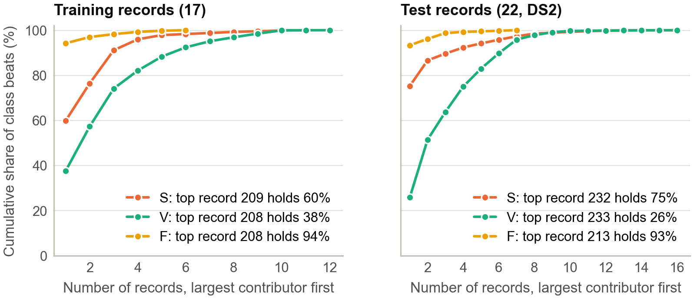
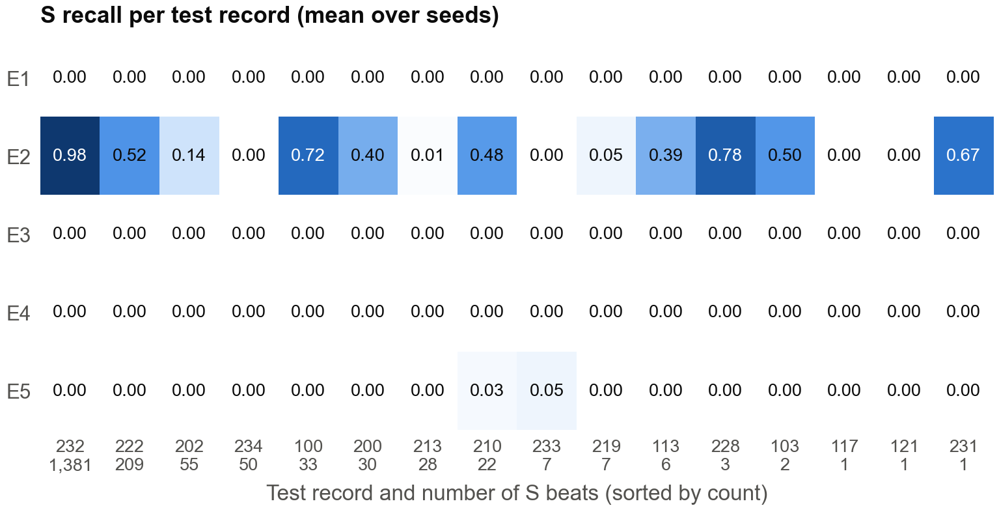
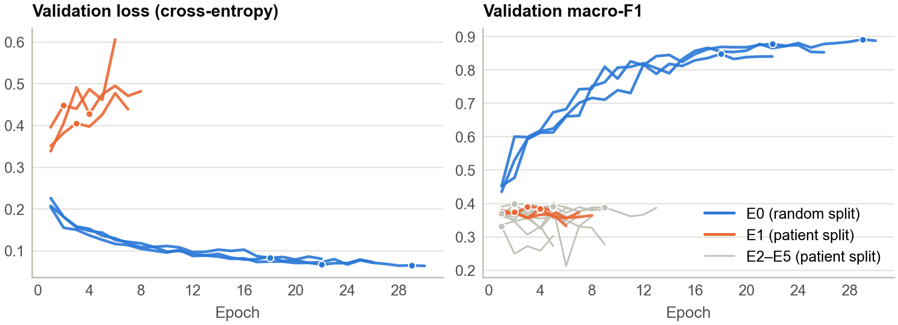
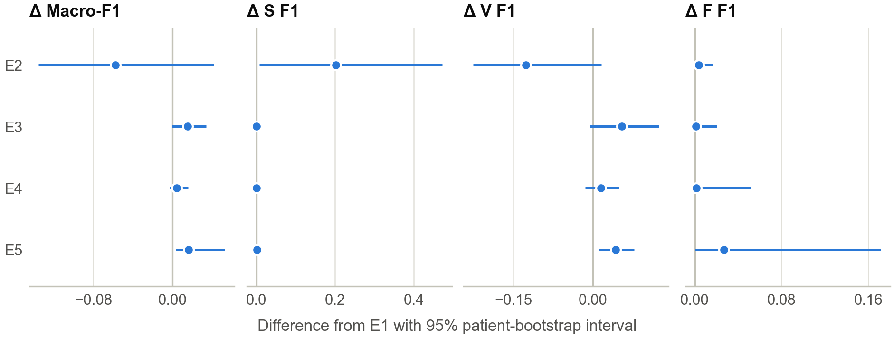

<!--
Assembled full report, draft v1 (M3, 31 Oct 2026). Built from M1_REPORT_INSERT.md,
M1_RELATED_WORK.md, M3_*.md and M2's training facts (checkpoints and histories).
Citations are keys from REFERENCES_VERIFIED.md; tools/build_report.py numbers them in
order of first use and writes the reference list. HTML comments are not printed.
Build: python tools/build_report.py  ->  SC4001_ECG_Report_draft.docx (+ .pdf via Word)
Every number comes from results/summary/summary.md, results/export_check.csv,
results/*/seed*_history.csv or results/data_analysis/data_facts.json.
-->

<!-- cover -->
Do ECG Heartbeat Classifiers Generalise to Unseen Patients?
A Controlled Study of a 1D CNN on MIT-BIH
SC4001 Neural Networks and Deep Learning: Group Project Report
Group [number]
Huang Yitian: evaluation and report (M3)
[M1 full name]: data and features (M1)
[M2 full name]: models and training (M2)
November 2026
<!-- /cover -->

# 1 Introduction

Automatic heartbeat classification from the electrocardiogram (ECG) supports long-term
monitoring, where a single day of recording contains around 100,000 beats. The MIT-BIH
Arrhythmia Database [Moody2001, Goldberger2000] is the standard benchmark, with beats
grouped into the AAMI classes normal (N), supraventricular ectopic (S), ventricular ectopic
(V), fusion (F) and unknown (Q) [AAMI2012].

Reported results depend heavily on how beats are split. If beats from all recordings are
pooled and divided at random (the *intra-patient* paradigm), beats from the same person
appear in both the training and the test set, so a model can succeed by recognising the
person rather than the arrhythmia. Under this paradigm deep models report near-perfect
scores, for example 100% S sensitivity at 96.5% positive predictivity [Mousavi2019]. When
training and test recordings are disjoint (the *inter-patient* split of de Chazal et al.
[deChazal2004]) the task is much harder: their classifier found 75.9% of S beats at a
positive predictivity of only 38.5%, and Sellami and Hwang report 99.48% accuracy
intra-patient but 88.34% inter-patient [Sellami2019]. The same pattern appears across
clinical machine learning: record-wise validation often overestimates accuracy compared
with subject-wise validation [Saeb2017], and leakage between training and test data has
produced over-optimistic conclusions in many fields [Kapoor2023]. A deployed classifier
always meets a new patient, so only a patient-wise evaluation answers the clinically
relevant question.

The patient-wise benchmark has a difficulty of its own: abnormal beats are rare and
concentrated in a few people. In the standard test set (DS2; 49,661 beats after our
preprocessing) S beats make up 3.7% of beats, and one recording, 232, contains 75% of
them; recording 213 contains 93% of the test F beats. Predicting N for every beat already
scores 89.0% accuracy, with a macro-F1 of only 0.24.

This project asks **how much a 1D convolutional neural network (CNN) loses when it is
evaluated on patients it has never seen, and whether inexpensive changes recover the rare
abnormal classes.** We train one baseline on a random beat split and on a subject-disjoint
patient split, and then test four changes, each aimed at a suspected cause of the gap:
class-weighted and focal losses for class imbalance [Cui2019, Lin2017], waveform
augmentation for differences in recording conditions [Um2017, Iwana2021], and RR-interval
features, because S beats are mostly early relative to the local rhythm while their shape
resembles that of N beats. Our contributions are:

- A controlled measurement of the gap: macro-F1 falls from 0.874 to 0.429, and S and F F1
  fall from 0.74 and 0.81 to zero. Our patient split is fully subject-disjoint; records 201
  and 202 come from the same person, which the conventional split ignores.
- A comparison of four fixes over three seeds, with per-class sensitivity, positive
  predictivity and F1, per-patient results and patient-bootstrap intervals. None recovers
  S detection; class weighting appears to, but only by labelling whole patients as S.
- A failure analysis showing that RR features teach the network to rank S beats correctly
  *within* a patient (AUROC 0.994 in record 232) even though it never predicts S, and that
  a decision threshold set on other patients does not fix this.
- A data analysis explaining why timing does not transfer: 62% of training S beats lie
  inside tachycardia runs, where they are not early, while most test S beats are isolated
  early beats.

# 2 Review of Existing Techniques

## 2.1 Heartbeat classification on MIT-BIH

<!-- M2's area; condensed from M3's starter text (M3_RELATED_WORK.md 2.1). M2 to check. -->
MIT-BIH contains 48 half-hour two-channel recordings from 47 subjects, sampled at 360 Hz
[MITDB, Moody2001]. De Chazal et al. [deChazal2004] set the reference inter-patient
protocol: the 44 non-paced recordings are divided into two sets of 22 (DS1 and DS2), one
used to develop the classifier and the other only for the final assessment; their
statistical classifier combined morphology and heartbeat-interval features. Later
feature-based work targeted generalisation directly, selecting features by cross-database
criteria [Llamedo2011] or combining RR intervals with several morphological descriptors in
an ensemble of support vector machines [MondejarGuerra2019]. Deep networks learn features
from the waveform instead. Kiranyaz et al. [Kiranyaz2016] trained a 1D CNN for each
patient from common plus patient-specific labelled beats, which avoids the inter-patient
problem but needs labelled beats from every new patient. Inter-patient deep models include
a symbolic representation with baseline correction that reduces inter-patient variation
[Niu2020] and networks evaluated under both paradigms [Mousavi2019, Sellami2019]. A deep
network trained on 53,549 patients and tested on an independent set [Hannun2019] shows what
many patients make possible; MIT-BIH offers 47 subjects, so patient-level generalisation is
the main constraint here.

Class imbalance is detrimental to CNNs, and accuracy is a poor metric under it [Buda2018].
Common remedies change the loss: class weights raise the cost of errors on rare classes
[Cui2019], focal loss down-weights well-classified examples so that training focuses on
hard ones [Lin2017], and Sellami and Hwang proposed a batch-weighted loss for heartbeats
[Sellami2019].

## 2.2 Timing features and data augmentation

Heartbeat classification can combine waveform morphology with temporal context. De Chazal
et al. [deChazal2004] used heartbeat-interval features with separate development and
evaluation records; this motivates our comparison between a waveform-only CNN and one that
also receives RR features, although our model and four-feature RR vector differ from
theirs. Training-time augmentation is another way to improve robustness without enlarging
the model. Nonaka and Seita [Nonaka2020] studied ECG augmentation for single-lead
atrial-fibrillation classification, and Raghu et al. [Raghu2022] found augmentation
effects to depend on the prediction task and learned task-specific policies. We instead fix
a small, interpretable set of gain, noise, baseline and shift perturbations and evaluate it
as one controlled change.

## 2.3 Evaluation protocols and patient-level uncertainty

An evaluation is only meaningful if the relationship between training and test data
matches that between training data and future use [Saeb2017]. Even the conventional
inter-patient split is not fully subject-disjoint: records 201 (DS1) and 202 (DS2) come
from the same person, and PhysioNet advises keeping them in one partition for
subject-independent work [MITDB]. How results are summarised also matters. ANSI/AAMI EC57
emphasises record-by-record reporting [AAMI2012], yet headline inter-patient results are
single figures per class, pooled over DS2. Such pooled figures are dominated by a few
recordings, and beats from one patient are not independent, so intervals that treat beats
as independent samples are too narrow. Resampling whole clusters, here patients, is the
standard bootstrap for clustered data [Field2007, Davison1997, Efron1993]. We therefore
report per-record results, results without the dominant records, and patient-bootstrap
intervals alongside the pooled metrics.

# 3 Data and Methods

## 3.1 Data and preprocessing

We used the MIT-BIH Arrhythmia Database v1.0.0 [MITDB], excluding the paced records 102,
104, 107 and 217, and verified every file against the publisher's checksums. Annotations
were mapped to four classes: N = {N, L, R, e, j}, S = {A, a, J, S}, V = {V, E} and F = {F};
Q beats and non-beat annotations were excluded. Around each annotated beat centre we took
256 samples (0.71 s) of lead MLII without resampling or filtering, and removed beats
without a complete window or without previous and next RR intervals, leaving 100,630
beats. Waveforms and RR features were standardised with the mean and SD of each
protocol's training beats only.

## 3.2 Partitions

E0 uses a random split of all beats, stratified by class (64/16/20% for training,
validation and test; split seed 42). E1–E5 use the inter-patient split: training on DS1
and testing on DS2, with DS1 records 108, 118, 203 and 223 held out for early stopping.
DS2 was used only for the final evaluation. Because records 201 and 202 come from one
subject, our main protocol also removes record 201 from training, giving 17 training,
4 validation and 22 test subjects with no overlap (Table 1). The two protocols also differ
in which patients are tested and in training size, so an E0–E1 difference cannot be
attributed to patient overlap alone. Abnormal beats are concentrated in a few records
(Fig. 1): record 209 holds 60% of the training S beats and record 208 holds 94% of the
training F beats, while in the test set record 232 holds 75% of the S beats and record 213
holds 93% of the F beats.

**Table 1.** Beats per partition after preprocessing (main protocols).

| Protocol | Training | Validation | Test |
|---|---|---|---|
| Random (E0) | 64,404 | 16,101 | 20,125 |
| Patient, subject-disjoint (E1–E5) | 39,394 (N 35,719; S 640; V 2,640; F 395) | 9,614 (N 8,472; S 175; V 950; F 17) | 49,661 (N 44,218; S 1,836; V 3,219; F 388) |

{width=6.0}

## 3.3 RR features and augmentation

For E5 we computed four RR features from consecutive annotated beats: the previous and the
next RR interval, the mean of up to ten preceding RR intervals, and the ratio of the
previous interval to that mean, a prematurity index on which values below 1 mark an early
beat. Because of the next-RR feature, the task is offline classification. For E4, each
training beat independently receives, each with probability 0.5, gain scaling in
[0.9, 1.1], Gaussian noise (SD 0.02), sinusoidal baseline wander (amplitude 0.05,
0.1–0.5 Hz) and a shift of up to eight samples. Labels and RR features are unchanged, and
validation and test beats are never augmented.

## 3.4 Model and training

<!-- M2's area; written by M3 from src/models.py, src/pretrain.py and the checkpoints. M2 to check. -->
All experiments use one small 1D CNN with 13,508 parameters. Three convolutional blocks
(16, 32 and 64 channels; kernel sizes 7, 5 and 5; stride 2; group normalisation and ReLU)
map a beat of 1 × 256 samples to 64 × 32 features; global average pooling gives a
64-dimensional embedding and a linear layer outputs the four class logits. In E5 the four
standardised RR features are concatenated to the embedding before the linear layer (13,524
parameters). We trained with AdamW (learning rate 10⁻³, weight decay 10⁻⁴, batch size 256)
for at most 30 epochs, kept the checkpoint with the best validation macro-F1, and stopped
after 4 epochs without improvement. E2 weights the cross-entropy by inverse training-class
frequency, normalised to mean 1 (N 0.025, S 1.389, V 0.337, F 2.250); E3 uses focal loss
with γ = 2 [Lin2017]. Each configuration was trained with seeds 42, 43 and 44 on a GPU.

## 3.5 Evaluation

We report per-class sensitivity (Se, recall), positive predictivity (+P, precision) and
F1, and the macro-F1 over the four classes, as mean ± SD over the three seeds. Test
predictions were exported once from the frozen checkpoints. Before any test beat was read,
the processed arrays passed the data audit and every checkpoint reproduced its stored
validation macro-F1 on our copy of the data (largest difference 3 × 10⁻⁴, from GPU/CPU
rounding). Because two records dominate the test S and F beats, we also report S without
record 232 and F without record 213 as sensitivity analyses. To show how much a result
depends on which patients are tested, we resampled the 22 test records with replacement
2,000 times, using the same draws for every model, and report 95% percentile intervals for
each metric and for its paired difference from E1.

# 4 Experiments and Results

## 4.1 Experiments and hypotheses

E0 (random split) and E1 (patient split) use the baseline CNN with cross-entropy. E2–E5
each change one element relative to E1: class-weighted loss (E2), focal loss (E3),
augmentation (E4) and RR features (E5). Before any training run, we wrote down five
hypotheses: the gap is large and concentrated in S and F (H1); weighted and focal losses
raise rare-class sensitivity at the cost of +P (H2); augmentation helps little (H3); RR
features give the largest S gain (H4); and no conclusion about F will be robust (H5). A
sixth hypothesis, on autoencoder pretraining (E6), was not tested: M1 pretrained the
encoders, but no supervised E6 classifier was trained (Appendix B). Two analyses in
Section 4.4 were added after the first test evaluation and are marked *post-hoc*; no
model or threshold was selected on test data.

## 4.2 The generalisation gap (H1: supported)

**Table 2.** Main results on the full test set (mean ± SD over three seeds). n/a: the class was never predicted. \*Only one seed predicted any S beat.

| Exp | Model (test set) | Macro-F1 | S Se | S +P | S F1 | V F1 | F F1 |
|---|---|---|---|---|---|---|---|
| — | always predict N (patient) | 0.236 | 0 | n/a | 0 | 0 | 0 |
| E0 | baseline (random split) | 0.874 ± 0.009 | 0.618 ± 0.027 | 0.910 ± 0.017 | 0.736 ± 0.023 | 0.955 ± 0.005 | 0.814 ± 0.010 |
| E1 | baseline (patient) | 0.429 ± 0.002 | 0.000 ± 0.000 | n/a | 0.000 ± 0.000 | 0.756 ± 0.008 | 0.000 ± 0.000 |
| E2 | + weighted loss | 0.371 ± 0.067 | 0.830 ± 0.060 | 0.115 ± 0.013 | 0.201 ± 0.018 | 0.629 ± 0.102 | 0.004 ± 0.002 |
| E3 | + focal loss | 0.444 ± 0.017 | 0.000 ± 0.000 | n/a | 0.000 ± 0.000 | 0.811 ± 0.067 | 0.001 ± 0.002 |
| E4 | + augmentation | 0.433 ± 0.017 | 0.000 ± 0.000 | n/a | 0.000 ± 0.000 | 0.771 ± 0.061 | 0.001 ± 0.003 |
| E5 | + RR features | 0.445 ± 0.030 | 0.001 ± 0.001 | 0.167\* | 0.001 ± 0.002 | 0.799 ± 0.092 | 0.027 ± 0.047 |

The same network that reaches macro-F1 0.874 on a random beat split reaches 0.429 on
unseen patients (Table 2, Fig. 2). Accuracy hides this: it falls only from 0.980 to 0.923,
3.3 points above the 0.890 of always predicting N. As H1 predicted, the loss is
concentrated in the rare classes. S F1 falls from 0.736 to 0 and F F1 from 0.814 to 0,
while V F1 falls less, from 0.955 to 0.756. On unseen patients the baseline never predicts
S: 98.6% of the 1,836 test S beats are called N, and the F beats of record 213 are split
evenly between N and V.

{width=3.0}

## 4.3 Effect of the fixes (H2–H5)

**Table 3.** Change from E1 with 95% patient-bootstrap intervals (2,000 resamples of the 22 test records, seed-averaged), and S and F F1 without their dominant records.

| Exp | Δ Macro-F1 | Δ S F1 | Δ V F1 | Δ F F1 | S F1 without 232 | F F1 without 213 |
|---|---|---|---|---|---|---|
| E2 | −0.058 [−0.135, +0.042] | +0.201 [+0.008, +0.473] | −0.127 [−0.227, +0.016] | +0.004 [0.000, +0.017] | 0.027 ± 0.009 | 0.001 ± 0.001 |
| E3 | +0.015 [−0.001, +0.034] | 0 | +0.056 [−0.006, +0.126] | +0.001 [0.000, +0.020] | 0 | 0.002 ± 0.003 |
| E4 | +0.004 [−0.003, +0.016] | 0 | +0.015 [−0.014, +0.049] | +0.001 [0.000, +0.051] | 0 | 0.008 ± 0.013 |
| E5 | +0.016 [+0.004, +0.053] | +0.001 [0.000, +0.012] | +0.043 [+0.012, +0.079] | +0.027 [0.000, +0.172] | 0.006 ± 0.010 | 0.001 ± 0.001 |

- **H2, partly supported.** Class weighting (E2) raises S sensitivity from 0 to 0.83, but
  S +P is 0.115, so about eight of every nine S predictions are false; macro-F1 falls by
  0.058 (the interval includes zero), and V F1 and accuracy (0.530 ± 0.155) fall with it.
  Without record 232 the S gain almost disappears (S F1 0.027), and Section 4.4 shows that
  even the gain in record 232 is not beat detection. Focal loss (E3) does not change S or
  F; its small gains are in V.
- **H3, supported.** Augmentation (E4) changes macro-F1 by +0.004 [−0.003, +0.016] and
  detects no S beats.
- **H4, not supported.** E5 predicts S for almost no test beat (S Se 0.001). Its macro-F1
  gain, +0.016 [+0.004, +0.053], is the only macro-F1 interval that excludes zero, but it
  comes from V (+0.043), not from S.
- **H5, supported.** F F1 is at most 0.03 for every patient-split model; the largest,
  E5's 0.027, has an interval from 0 to 0.172 and comes from one seed. Training F beats
  come almost entirely from record 208 and test F beats from record 213.

Seed spreads are large for the patient-split models (for example ± 0.09 in V F1 for E5)
and the bootstrap intervals are wide: which patients are tested matters as much as which
fix is used. Fig. 3 shows S sensitivity for each test record.

{width=6.3}

## 4.4 Failure analysis

**Where are the errors?** For E1, two records account for 86% of the S errors: record 232
(1,379 S beats called N, 99.9% of its S beats) and record 222 (all 209 S beats called N).
The other large error cells are record 213 (363 N beats called V; F beats split between N
and V) and record 233 (202 V beats called N, 24%).

**Did the models learn S on the training patients?** On training and validation data
only, the selected checkpoints of E1, E3, E4 and two of the three E5 seeds detect at most
3% of the S beats in their own training set. Early stopping kept epochs 1–5 in 14 of the
15 patient-split runs (epoch 9 in the other), against 18–29 for E0, because validation
macro-F1 stopped improving almost at once while the validation loss of E1 rose from the
first epochs (Fig. 4). The models that did fit S still fail on new patients: E2 detects
85–90% of its training S beats and E5 (seed 42) 61%, yet they find at most 8% of the S
beats of the validation patients. Two failures therefore stack: model selection stops
before S is learned, and S learned on the training patients does not transfer.

{width=6.3}

**E2 labels patients, not beats** *(post-hoc)*. Class weighting makes E2 call 98% of all
beats in record 232 S, including 99% of that record's 397 N beats. Because 78% of the
record's beats are S, this produces most of the S "gain". The same behaviour produces the
false positives: 92% of the N beats of record 212 (2,530 of 2,746) are called S, as are
80% of those of record 222 and 68% of those of record 100. Within record 232, E2's S
probability separates S from N beats no better than chance (AUROC 0.48 ± 0.06).

**E5 ranks S beats correctly but never predicts them** *(post-hoc)*. Table 4 measures how
well each model's S probability ranks S beats above all other beats, across all test beats
pooled and within each record. Pooled AUROC looks moderate for every patient-split model
(0.75–0.86), but within records E1–E4 are at or below chance (median 0.46–0.48): their
pooled score separates patients, not beats. E5 is the exception. Within record 232 its S
probability separates S from N almost perfectly (AUROC 0.994), and the median over records
is 0.895, yet the argmax never selects S.

**Table 4.** *(Post-hoc.)* AUROC of the S probability for S versus all other beats, mean over seeds. Within records: median over the 8 test records with at least 10 S and 10 other beats.

| Exp | Pooled | Within records (median) | Within record 232 | Share of record 232 predicted S |
|---|---|---|---|---|
| E0 (random split) | 0.963 | 0.943 | 0.948 | 0.775 |
| E1 | 0.753 | 0.467 | 0.429 | 0.000 |
| E2 | 0.859 | 0.478 | 0.482 | 0.983 |
| E3 | 0.863 | 0.475 | 0.461 | 0.000 |
| E4 | 0.762 | 0.457 | 0.419 | 0.000 |
| E5 | 0.863 | 0.895 | 0.994 | 0.000 |

**Would a better threshold fix it?** *(Post-hoc; thresholds chosen on validation patients
only.)* We predicted S whenever the S probability exceeded the threshold that maximised S F1
on the four validation records. For no model does this transfer. For E1, E2 and E4 the
threshold labels most test beats S (S Se 0.94–1.00, +P 0.04–0.07). E3 reaches S F1
0.21 ± 0.11, but with within-record ranking at chance this again labels patients rather
than beats. For E5 the outcome depends on the seed (S Se 0.62 ± 0.45, +P 0.11 ± 0.05,
S F1 0.15 ± 0.08), and macro-F1 is no better than with the argmax (0.420 against 0.445).
The scores are informative within a patient but not comparable between patients.

**Why does timing not transfer?** In the training set, 62% of S beats (395 of 640) occur
inside supraventricular tachycardia runs, mostly in record 209, where they are not early
relative to the preceding beats. Only 48.9% of training S beats have a prematurity index
below 0.9, against 87.7% of test S beats (Fig. 5). Within record 232, S beats correlate at
r = 0.975 with that record's N beats in shape; their timing is what differs. The cue that
defines most test S beats is therefore weak in training.

{width=4.0}

# 5 Discussion and Limitations

**The headline number depends on the split.** The same 13.5k-parameter CNN, trained in the
same way, scores macro-F1 0.874 when beats are split at random and 0.429 when the test
patients are new, and on new patients it detects no S or F beats. This matches the
direction reported in the literature [deChazal2004, Sellami2019] and shows how far the
random-split number overstates what a deployed model would do.

**Why the inexpensive fixes did not recover S.** Reweighting the loss (E2) did not teach
the network what an S beat looks like in a new patient; it taught the network to call whole
patients S. Imbalance is real, but it is not what blocks generalisation. Augmentation (E4)
simulates gain, noise and baseline changes, while the S beats of record 232 differ from its
N beats in timing, not shape, so, as expected, it did not help. RR features (E5) did teach
the right cue: within record 232 the network ranks S above N almost perfectly. But no test
beat crosses the decision boundary, and a threshold chosen on the validation patients does
not help, because S scores are not comparable between patients. The training data teach a
weaker timing cue than the test patients need.

**Pooled metrics can mislead.** The gap between pooled and within-patient AUROC (0.75–0.86
against 0.46–0.48 for E1–E4) shows that a pooled ranking metric can look reasonable when a
model only separates patients with many S beats from patients with few. Within-patient
analysis exposes this, and we recommend reporting it alongside pooled scores.

**Model selection under patient shift.** Early stopping on validation macro-F1 chose epochs
1–5 in 14 of 15 patient-split runs, before the network had learned S even on its training
patients. This is itself a symptom of the shift: learning S on the training patients did
not raise validation macro-F1, because the validation patients' S beats differ. Where S was
learned (E2 and one E5 seed), validation S sensitivity stayed at or below 0.08, so the
failure to generalise does not depend on the early stop. Still, E3–E5 partly compare
under-trained models, and a selection rule that does not rely on four validation patients
would make the comparison cleaner.

**Limitations.** (i) *Few patients*: 22 test patients, two of whom hold most of the S
(record 232: 75%) and F (record 213: 93%) beats, so S and F conclusions describe a handful
of individuals, and a 22-record bootstrap is itself approximate [Efron1993]. (ii) *Weak
validation set*: four patients with 175 S and 17 F beats guide early stopping and threshold
choice. (iii) *Statistics*: three seeds per configuration, SDs up to 0.155 (E2 accuracy),
intervals instead of significance tests, and no correction for comparing four fixes.
(iv) *Data*: one lead, annotated beat locations instead of a detector, an offline next-RR
feature, paced records and the Q class excluded, and no external test database.
(v) *Post-hoc analyses*: the ranking and threshold analyses were designed after we saw the
first test results; they explain the failure and were not used to select any model.

**Future work.** The within-patient result suggests that the missing step is per-patient
calibration rather than more features: normalising RR features by each patient's own
rhythm, adapting the threshold with a few labelled beats from the new patient, as in
patient-specific training [Kiranyaz2016], or unsupervised test-time adaptation. Each needs
a validation design with more patients, for example leave-one-patient-out on DS1.

# 6 Conclusion

On MIT-BIH, a 1D CNN that scores macro-F1 0.874 on a random beat split scores 0.429 on
patients it has not seen and detects none of their S or F beats. Four inexpensive fixes did
not change this. Class weighting raised S sensitivity to 0.83, but only by labelling entire
patients S (S +P 0.115); focal loss and augmentation had no effect on S; RR features gave
the only reliable macro-F1 gain (+0.016, through V). Their main effect was hidden: the model
learned to rank S beats correctly within each patient (AUROC 0.994 in record 232) but never
predicted them, and a threshold chosen on other patients did not fix this. Patient-wise
evaluation should report per-patient results and within-patient ranking alongside pooled
scores, because pooled scores can hide both failures and partial successes. The next step
is to calibrate decisions per patient.

# AI Use Statement

<!-- M2: confirm the exact tool/model name and say how outputs were checked.
     Yitian: add one sentence on how you reviewed and revised the M3 text. -->
We used generative AI tools in all three roles, and each member checked the output of the
tool they used. M1 used OpenAI Codex for the data pipeline, tests, autoencoder
pretraining, documentation, drafts of the data and related-work text, and an assisted
review of M3's code; outputs were checked with protocol tests, publisher checksums and
reruns on the real data. M2 used [OpenAI GPT 6; M2 to confirm] for help with coding,
debugging and environment set-up; [M2: how the outputs were checked]. M3 used Claude Code
(Claude Opus 5.5) for the prediction-export, evaluation and figure code, the post-hoc
analyses, reference checking and first drafts of Sections 1, 2.3 and 4–6; the code was
checked with unit tests (including cross-checks against scikit-learn), every reported
number was regenerated from the code's output, and every reference was checked against the
publisher, PubMed or arXiv record. [Yitian: how you reviewed and revised the text.] Our
team chose the research question, the subject-disjoint protocol and the experiments,
decided how to report the early-stopping problem, and interpreted the results. Every result
comes from experiments we ran.

\newpage

# References

<!-- references -->

# Appendix

## A Reproducing the results

The code and full instructions are in the repository README. From the repository root:

- `python -m src.prepare` builds and audits the data.
- `python -m src.train --experiments all --seeds 42 43 44 --epochs 30 --patience 4`
  trains E0–E5 (needs a CUDA GPU).
- `python -m src.predict` exports test predictions from the committed checkpoints (CPU is
  enough).
- `python -m src.evaluate summarise --reference E1` writes every table and figure in this
  report to `results/summary/`.

## B Autoencoder pretraining (E6)

M1 pretrained six convolutional autoencoders (the encoder above with a mirrored decoder;
two training cohorts × three seeds, ten epochs, AdamW) on training waveforms only, without
labels, validation or test data. The encoders pass the provenance audit, but no supervised
E6 classifier was trained, so the pretraining hypothesis remains untested. Reconstruction
diagnostics are in `docs/report/M1_E6_RESULTS.md`.

## C Bootstrap differences

{width=6.3}
